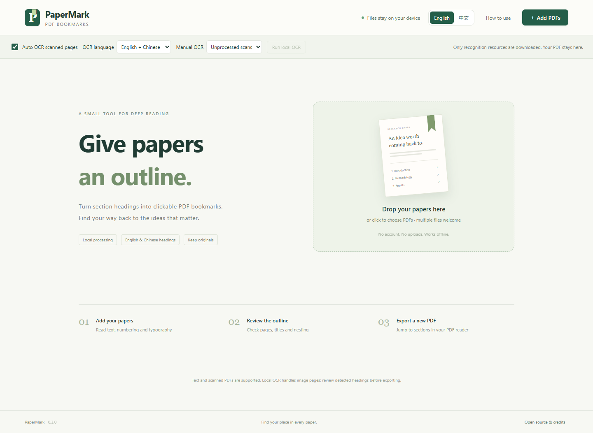

# PaperMark

[简体中文](README.zh-CN.md)

Give research papers a clickable outline. PaperMark detects section headings in PDFs, lets you review and edit the bookmarks, and exports a new PDF. It runs locally in your browser, including without an internet connection.

## Open online or download

**[Open PaperMark in your browser](https://laginae.github.io/papermark/)** — no download or installation required.

Download **PaperMark.html** from the [latest release](https://github.com/laginae/papermark/releases/latest), then open it in a recent desktop browser. No installer, account or server is required. An offline ZIP is also available.

1. Add one or more PDFs. Papers without bookmarks are analyzed automatically.
2. Review the outline against the page preview. Edit titles, nesting, page numbers and positions as needed.
3. Export a PDF, or export available documents together as a ZIP. Open the bookmarks/outline panel in your PDF reader to navigate.

The interface starts in **English**. Use the **English / 中文** buttons in the top bar to switch, including while a PDF is being processed. The choice is remembered when browser storage is available. Switching languages preserves the loaded files and edits; it never translates paper text or bookmark titles.



## Features

- English and Chinese heading detection using numbering, font size and page layout.
- Local OCR for scanned pages, with English and Simplified Chinese models, progress and cancellation.
- Balanced and conservative detection, with uncertain candidates marked for review.
- Page preview, editable nested bookmarks and click-to-position destinations.
- Load existing bookmarks, undo edits and save/load outline JSON for the same original PDF.
- Batch PDF export as ZIP with an export report.
- Single offline HTML file with embedded PDF and OCR workers, recognition models, character maps, fonts and WebAssembly resources.

## Scanned PDFs

**Auto OCR scanned pages** is enabled by default. Before adding a PDF, choose English, Simplified Chinese or both under **OCR language**. A document without an existing outline is checked for pages with little extractable text; these pages are rendered and recognized locally. Existing outlines are loaded without automatic OCR.

Review the generated headings and destinations before exporting. OCR bookmarks are marked for review. **Cancel** stops recognition and keeps completed pages. **Run local OCR → Unprocessed scans** resumes remaining pages; choose **All pages** to repeat recognition with another language or process a poor text layer. Rebuilding an existing outline asks for confirmation and can be undone.

OCR is intended for upright, legible printed text. Blurry, skewed, complex or handwritten pages may need manual correction. It can be slow, particularly on large PDFs or mobile devices. OCR is used to create bookmarks; it does not add a searchable text layer or alter the scanned page images.

## Privacy and file handling

PDF processing and OCR happen in browser memory. The app has no upload endpoint, telemetry or account system. Only the language preference is written to browser storage; PDF data and OCR text are not stored in IndexedDB or local storage. Refreshing or closing the page loses loaded files and edits.

The online version downloads the static application from GitHub Pages. The first OCR operation in a tab also loads about 10 MB of fixed recognition resources from the same site and verifies their SHA-256 hash. These requests contain no PDF contents, filename or recognized text. Once these resources are loaded, OCR can continue without a connection while the tab stays open. The OCR worker uses bundled data and rejects external resource requests. GitHub receives ordinary requests for the site files, as with any hosted web page.

Opening or refreshing the online page may need a connection. For reliable offline access, download the full **PaperMark.html** (about 17 MB); it includes the OCR resources and works without a first-run download.

Export creates a new file; it does not overwrite the original. Saved outline JSON includes the original filename, SHA-256 fingerprint and bookmarks. Batch reports include filenames and export results. These downloads remain on your device unless you choose to share them.

Adding bookmarks is **not anonymization**: existing PDF metadata, text and annotations remain part of the exported document. Review your files before sharing them.

## Scope and limitations

- Supports selectable-text PDFs and local OCR of English/Simplified Chinese scans. Other languages need manual bookmarks or an external OCR tool.
- Detection is heuristic and needs review, especially for unusual layouts. It does not insert a printed table-of-contents page.
- Encrypted PDFs, signed PDFs, writing restrictions and unsupported original outline targets prevent export.
- Limits: 100 MB and 2,000 pages per PDF; 20 files and 250 MB total; up to 1,000 new bookmarks. Large files can use substantially more memory than their file size.
- Designed for current desktop Chrome, Edge, Firefox and Safari. Release 0.3.0 was checked in Chrome on Windows; macOS, Linux and other browsers have not been verified for this release. Mobile local-HTML support varies; a static web host may be needed.
- Page numbers are physical PDF pages, starting at 1, rather than printed page labels.

## Build from source

Use Node.js 22.13 or later and npm:

```sh
npm ci
npm run fixtures
npm test
npm run build
```

Open `dist/PaperMark.html`, or use `npm run serve` and the local URL it prints. `npm run serve -- --web` serves the hosted variant with lazy OCR resources. Building requires downloading locked npm dependencies; using the finished standalone HTML does not require a network connection.

`npm run audit:public` checks the publication allowlist for common private-path and credential patterns. `npm run package` creates the offline and source ZIPs plus SHA-256 checksums under `release/`. Generated test PDFs and browser logs are excluded from publication. Tests generate only synthetic research documents.

## GitHub Pages deployment

The Pages workflow checks build hashes and audits public files, then publishes `dist/index.html`, the hashed OCR resource JSON, the build manifest and the license. The web HTML differs from `PaperMark.html`: it loads the OCR resource bundle on demand. There is no server component or upload API. The manifest records separate hashes for the standalone HTML, web HTML and OCR resources.

After changing the app, build it and commit the updated `dist/` files to `main`; the workflow deploys automatically. It also supports manual dispatch. In a fork, enable **Settings → Pages → Source → GitHub Actions** before running the workflow. `node scripts/prepare-pages.cjs` prepares the same site locally under the ignored `_site/` directory.

## Credits and license

PaperMark is released under the [MIT license](LICENSE). PDF layout and bookmark foundations are adapted from [Note and PDF Voice Reader](https://github.com/laginae/note-reader-cosyvoice) / note-reader-core, with their MIT notices preserved. PDF parsing and rendering use [Mozilla PDF.js](https://github.com/mozilla/pdf.js); writing uses [pdf-lib](https://github.com/Hopding/pdf-lib); ZIP export uses [fflate](https://github.com/101arrowz/fflate). Local OCR uses [Tesseract.js](https://github.com/naptha/tesseract.js) and bundled English/Simplified Chinese data; see [OCR provenance](licenses/OCR-NOTICES.md).

Upstream notices are in [licenses/](licenses/) and embedded in the app's credits dialog. See [CHANGELOG.md](CHANGELOG.md) for release changes and [docs/verification.md](docs/verification.md) for the validation scope.
