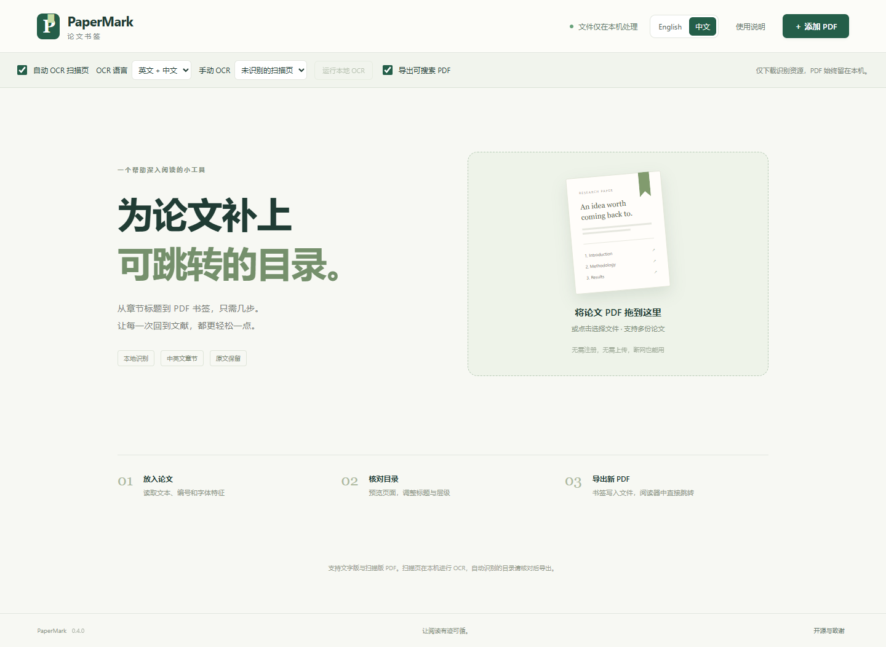

# PaperMark

[English](README.md)

为论文 PDF 添加可以跳转的书签目录。自动识别章节标题，核对和编辑后导出新的 PDF。全部处理在浏览器本机完成，支持离线使用。

## 在线使用或下载

**[直接在浏览器打开 PaperMark](https://laginae.github.io/papermark/)**，无需下载或安装。

从[最新发行版](https://github.com/laginae/papermark/releases/latest)下载 **PaperMark.html**，用较新的桌面浏览器打开即可。无需安装程序、注册账号或启动服务器，也可下载离线 ZIP 包。

1. 添加一份或多份 PDF。没有书签的论文会自动识别章节。
2. 对照页面预览核对目录，调整标题、层级、页码和跳转位置。
3. 导出单份 PDF 或批量 ZIP，在阅读器的“书签/大纲”面板中使用。

界面**默认英文**，点击右上角语言菜单选择 **简体中文** 即可切换。浏览器允许存储时会记住选择。切换语言保留当前文件和编辑，不翻译论文正文或书签标题。



## 功能

- 根据编号、字体和版式识别中英文章节，提供均衡与保守模式。
- 标记需要核对的候选标题，支持原文预览和点击定位。
- 编辑多级书签，读取原有书签，撤销修改。
- 保存目录 JSON，重新打开同一份原 PDF 后可以载入继续编辑。
- 批量导出 ZIP，并附导出结果报告。
- PDF 运行组件、字形映射、字体和 WebAssembly 资源全部内嵌于单个 HTML。

## 隐私与文件

PDF 在浏览器内存中处理，没有上传接口、遥测、账号系统或远程运行资源。浏览器仅保存语言偏好。刷新或关闭页面会丢失当前文件和编辑。

在线版首次打开时从 GitHub Pages 获取静态应用。选择 PDF 不会把文件内容或文件名发送到 GitHub。页面加载完成后，保持标签页打开，即使断网也能处理 PDF；重新打开或刷新网页可能需要联网。需要稳定的离线访问时，可使用下载版 HTML。

导出另存为新文件，不覆盖原文。目录 JSON 含原文件名、SHA-256 指纹与书签；批量报告含文件名和导出结果。这些下载文件由使用者自行保管和决定是否分享。

添加书签**不等于匿名化 PDF**：原有元数据、正文与批注仍在导出文档中，分享前请自行检查。

## 适用范围

- 主要面向可选中文字的 PDF。没有内置 OCR；扫描页或无法正常提取文本的页面需先 OCR 或手工添加书签。
- 自动识别不能保证适用于所有期刊版式，建议核对后导出。不会在论文中插入纸面目录页。
- 加密、带数字签名、存在写入限制或含不支持的原目录目标时禁用导出。
- 单份最大 100 MB、2,000 页；列表最多 20 份、合计 250 MB；最多写入 1,000 个新书签。大文件的内存占用可能显著高于文件大小。
- 面向较新的桌面 Chrome、Edge、Firefox、Safari。0.2.0 已在 Windows Chrome 验证；此版未实际验证 macOS、Linux 和其他浏览器。手机系统的本地 HTML 支持不同，部分需要通过静态网页地址访问。
- 页码是从 1 开始的 PDF 实际页序，不是论文印刷页码。

## 从源码构建

需要 Node.js 22.13 或更高版本及 npm：

```sh
npm ci
npm run fixtures
npm test
npm run build
```

打开 `dist/PaperMark.html` 即可。也可执行 `npm run serve` 并访问提示的本地地址。构建需要下载锁定的 npm 依赖，使用成品 HTML 不需要联网。

`npm run audit:public` 检查发布白名单内的常见私人路径和凭据特征。`npm run package` 在 `release/` 生成离线包、源码包和 SHA-256 校验文件。生成的测试 PDF 与浏览器日志不进入发布包，测试文档均为合成样例。

## GitHub Pages 部署

部署流程检查构建哈希并审查公开文件，将已提交的 `dist/PaperMark.html` 作为网站 `index.html` 发布。网站只包含该 HTML、构建清单与许可证，没有服务端程序或上传接口。

修改应用后重新构建，将更新的 `dist/` 文件提交到 `main` 即可自动部署，也可以手动触发工作流。Fork 仓库时需先在 **Settings → Pages → Source** 选择 **GitHub Actions**。执行 `node scripts/prepare-pages.cjs` 可在本机准备相同的网站文件，输出到不纳入版本控制的 `_site/` 目录。

## 开源许可

项目采用 [MIT 许可](LICENSE)。PDF 布局和书签基础逻辑参考 [Note and PDF Voice Reader](https://github.com/laginae/note-reader-cosyvoice) / note-reader-core，保留 MIT 声明。PDF 解析与预览使用 Mozilla PDF.js，写入使用 pdf-lib，ZIP 导出使用 fflate。

第三方声明见 [licenses/](licenses/) 及应用内“开源与致谢”。更新记录见 [CHANGELOG.md](CHANGELOG.md)，验证范围见 [docs/verification.md](docs/verification.md)。
